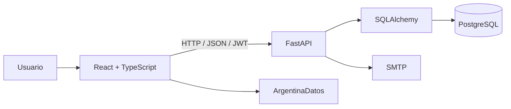

# Sistema de Gestión de Posgrados

### Universidad Tecnológica Nacional · Facultad Regional La Plata

Proyecto integrador de Desarrollo de Software — Ingeniería en Sistemas de Información · 3.er año · Turno noche · 2026.

[](#stack-tecnológico)
[](#stack-tecnológico)
[](#stack-tecnológico)
[](#instalación-y-ejecución)

## Descripción

Sistema web centralizado para digitalizar la gestión académica y administrativa de las carreras de posgrado de la UTN FRLP. Busca reemplazar los procesos dispersos en planillas, documentación física y correos electrónicos por flujos trazables, desde la inscripción del aspirante hasta el seguimiento académico y los trabajos finales.

## Equipo de desarrollo

| Integrante | Área de participación | Rama de trabajo |
|---|---|---|
| Ursula Martina Lazzaro | Head del frontend, integración, gestión académica y mejoras transversales | `rama-ursula` |
| Julián Stecanella | Desarrollo de funcionalidades de estudiantes y docentes | `rama-julian` |
| Matías Garcia Vidal | Desarrollo de funcionalidades de gestión académica y CPR | `rama-matias` |
| Jonathan Santurio | Head del backend, autenticación e inscripción | `rama-jony` |

Repositorio: [Ursulazzaro/postgrados_frlp](https://github.com/Ursulazzaro/postgrados_frlp).

## Alcance funcional

El proyecto desarrolla el núcleo de gestión de posgrados e incorpora funcionalidades de gestión docente, seguimiento académico y reportes. La disponibilidad de cada operación depende del perfil y del estado académico del legajo.

| Perfil | Funcionalidades |
|---|---|
| Público | Oferta académica, noticias, calendario, preguntas frecuentes, contacto e inscripción. |
| Aspirante | Inscripción, carga documental, seguimiento mediante número de seguimiento y corrección de solicitudes observadas. No requiere un dashboard privado. |
| Equipo de Conducción / Coordinador | Consulta de aspirantes por cohorte, revisión documental, observaciones, resolución de inscripciones, matriculación, seguimiento de legajos, consultas académicas, períodos de inscripción, estadísticas y exportaciones. |
| Administrador | Gestión de usuarios, carreras, cohortes, docentes, seminarios, asociaciones académicas, tutorías, sitio público, estadísticas y reportes. |
| Docente | Consulta de seminarios asignados, asociación de estudiantes habilitados, registro de asistencia, calificaciones y seguimiento de cursada. |
| Estudiante (`ALUMNO`) | Inscripción a seminarios disponibles, consulta del estado académico, asistencias, calificaciones, tutorías y seguimiento del trabajo final. |
| CPR | Consulta de estudiantes y docentes, gestión de trabajos prácticos, tutorías y seguimiento de tesis. |

### Flujos principales

**Inscripción y matriculación:** el aspirante completa su solicitud y documentación, recibe un número de seguimiento y consulta su estado públicamente. Conducción revisa los requisitos, solicita correcciones cuando corresponde y resuelve la inscripción. La matriculación habilita el legajo académico; la creación y activación de la cuenta permiten acceder al perfil de estudiante.

**Cursada:** el administrador registra seminarios y asigna docentes. Los estudiantes habilitados pueden inscribirse en seminarios de su carrera, y los docentes pueden asociar candidatos compatibles. El backend valida la pertenencia académica, el estado del legajo y la ausencia de inscripciones duplicadas. El docente registra asistencias y calificaciones.

**Seguimiento:** las consultas de legajos, tutorías, trabajos prácticos y tesis permiten acompañar el avance académico. Los indicadores, alertas y reportes facilitan las tareas de gestión según los permisos del usuario.

**Sitio público:** el administrador actualiza la información institucional, las noticias, preguntas frecuentes, eventos académicos y la configuración del calendario. Los eventos institucionales se obtienen del backend y los feriados se consultan mediante ArgentinaDatos, de forma independiente.

## Stack tecnológico

| Capa | Tecnología | Finalidad |
|---|---|---|
| Frontend | React, TypeScript, Vite | Interfaz web modular y compilación del cliente. |
| Navegación | React Router | Rutas públicas, privadas y navegación por perfil. |
| Estilos | CSS y Tailwind CSS | Diseño responsive y reutilización de estilos. |
| Backend | Python, FastAPI | API REST, reglas de negocio y control de acceso. |
| Persistencia | SQLAlchemy, asyncpg, PostgreSQL | Acceso asíncrono a datos y persistencia relacional. |
| Autenticación | JWT y control de acceso por roles | Identificación y autorización de operaciones. |
| Correo | SMTP con STARTTLS | Envío de comunicaciones institucionales y activación de cuentas. |
| Testing frontend | Vitest, React Testing Library | Pruebas de componentes, interacciones y flujos. |
| Testing backend | Pytest | Pruebas de servicios y reglas de negocio. |
| Infraestructura | Docker y Docker Compose | Ejecución reproducible de los servicios. |
| Control de versiones | Git y GitHub | Desarrollo colaborativo e integración. |

## Arquitectura

El sistema separa presentación, lógica de negocio y persistencia. El frontend consume la API REST del backend, que valida las operaciones y accede a PostgreSQL mediante SQLAlchemy.



El frontend se organiza por módulos funcionales y perfiles, con componentes, hooks, servicios API y estilos compartidos. En el backend, los módulos separan responsabilidades de presentación, aplicación, dominio e infraestructura según corresponda.

### Estructura general

```text
postgrados_frlp/
├── README.md
├── CONTRIBUTING.md
├── docker-compose.yml
├── .env.example
├── docs/
├── src/
│   ├── frontend/
│   │   ├── src/
│   │   │   ├── modulos/
│   │   │   │   ├── calendario/
│   │   │   │   ├── inscripcion/
│   │   │   │   ├── manejo-sesion/
│   │   │   │   └── perfiles/
│   │   │   │       ├── administrador/
│   │   │   │       ├── conduccion/
│   │   │   │       ├── cpr/
│   │   │   │       ├── docente/
│   │   │   │       ├── estudiante/
│   │   │   │       └── shared/
│   │   │   └── shared/
│   │   ├── tests/
│   │   └── package.json
│   └── backend/
│       ├── src/
│       └── tests/
└── .github/
```

## Instalación y ejecución

### Requisitos

- Git.
- Docker Desktop o Docker Engine con Docker Compose, en ejecución.
- Acceso a Internet para descargar las imágenes y dependencias iniciales.

Desde Git Bash:

```bash
git clone https://github.com/Ursulazzaro/postgrados_frlp.git
cd postgrados_frlp
[ -f .env ] || cp .env.example .env
docker compose up -d --build
```

En PowerShell, para crear el archivo de configuración si no existe: `if (!(Test-Path .env)) { Copy-Item .env.example .env }`.

| Servicio | Dirección |
|---|---|
| Frontend | http://localhost:3000 |
| Backend | http://localhost:8000 |
| Swagger / OpenAPI | http://localhost:8000/docs |
| Estado del backend | http://localhost:8000/health |

Compose inicia los servicios y conserva los datos en volúmenes. El backend inicializa las tablas según la configuración de arranque del proyecto.

### Variables de entorno

Consultar `.env.example` para conocer los nombres y valores de referencia. Configurar la clave JWT (`SECRET_KEY` o `JWT_SECRET`, según Compose), conexión a PostgreSQL, credenciales SMTP y, cuando corresponda, `VITE_RECAPTCHA_SITE_KEY`. ArgentinaDatos no requiere una clave de acceso. La disponibilidad de feriados depende del proveedor y del año consultado.

No versionar `.env`, contraseñas, tokens ni archivos personales cargados durante las pruebas. Las claves de desarrollo no deben utilizarse en producción.

### Comandos útiles

```bash
docker compose ps
docker compose logs -f backend frontend
docker compose up -d --build
docker compose down
```

`docker compose down` detiene los servicios sin eliminar los volúmenes por defecto. No usar `down -v` salvo que se quiera eliminar deliberadamente los datos persistidos.

## Testing y calidad de código

Para ejecutar las verificaciones del frontend localmente con Node.js y npm instalados:

```bash
cd src/frontend
npm ci
npm run build
npm run lint
npm run test:run
```

Prueba individual:

```bash
npm run test:run -- tests/gestion-inscripcion.test.tsx
```

Para el backend, con el servicio iniciado y las dependencias de pruebas disponibles:

```bash
docker compose exec backend python -m pytest
```

Las pruebas verifican, entre otros aspectos, autenticación, permisos, formularios, validaciones, confirmaciones de operaciones, inscripción, gestión documental, seminarios, tutorías y consultas académicas. La cobertura objetivo establecida por la cátedra es del 70 % en lógica nueva; el porcentaje real debe obtenerse mediante una ejecución de cobertura, no inferirse de la cantidad de tests aprobados.

## Seguridad, accesibilidad y mantenimiento

- Autorización de operaciones desde el backend y protección de rutas en el frontend.
- Validación de campos, documentos y transiciones de estados académicos.
- Confirmación de operaciones sensibles y prevención de envíos duplicados.
- Manejo de estados de carga, errores y ausencia de datos.
- Formularios con etiquetas, estructura semántica y mensajes accesibles.
- Componentes compartidos para reducir duplicación y mantener una experiencia consistente.
- Notificaciones y comunicaciones institucionales vinculadas a los flujos del sistema.

## Documentación

| Documento | Contenido |
|---|---|
| [SRS](docs/SRS.md) | Especificación de requisitos. |
| [BFD](docs/BFD.md) | Flujos del negocio. |
| [PRD](docs/PRD.md) | Requisitos funcionales y criterios de aceptación. |
| [Arquitectura](docs/ARQUITECTURA.md) | Decisiones y diseño técnico. |
| [ASR](docs/ASR.md) | Requisitos arquitectónicamente significativos. |
| [Cronograma](docs/CRONOGRAMA.md) | Planificación académica. |
| [Definition of Done](docs/DEFINITION_OF_DONE.md) | Criterios de calidad y completitud. |
| [Team Charter](docs/onboarding/TEAM_CHARTER.md) | Acuerdos del equipo. |
| [Setup local](docs/onboarding/SETUP_LOCAL.md) | Configuración y resolución de problemas. |
| [Contributing](CONTRIBUTING.md) | Reglas de colaboración. |

## Desarrollo colaborativo

El equipo trabaja con ramas individuales y mensajes de commit descriptivos. Conforme a las reglas de la cátedra, la integración a `main` debe realizarse mediante Pull Request con revisión, verificaciones de calidad y pruebas aprobadas. Los requisitos y decisiones técnicas se documentan en el repositorio.

## Estado del proyecto

Proyecto académico finalizado. La descripción del alcance no constituye una certificación de que todos los requisitos estén completos o de que todas las pruebas estén aprobadas.

---

**UTN FRLP · Desarrollo de Software · Ingeniería en Sistemas de Información · 2026**
