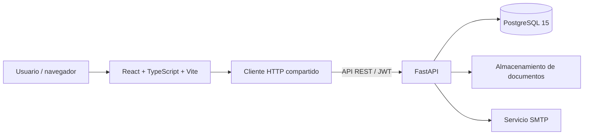

# Sistema de Posgrados UTN FRLP — Frontend

Aplicación web del Sistema de Gestión de Posgrados de la Universidad Tecnológica Nacional, Facultad Regional La Plata.

**Proyecto integrador — Desarrollo de Software · Ingeniería en Sistemas de Información · 2026**

## 1. Objetivo

Centralizar la gestión académica de posgrados mediante una aplicación web que acompaña al estudiante desde la inscripción pública hasta el seguimiento de su trayectoria académica.

El frontend proporciona un portal público y espacios privados diferenciados por rol. Consume los servicios del backend mediante una API REST y presenta información persistida en PostgreSQL.

## 2. Tecnologías

| Tecnología | Finalidad |
|---|---|
| React 19 | Construcción de interfaces mediante componentes |
| TypeScript | Tipado estático de datos, propiedades y respuestas de la API |
| Vite 8 | Servidor de desarrollo y compilación |
| React Router | Navegación y protección de rutas |
| CSS y Tailwind CSS | Estilos, diseño responsive y consistencia visual |
| Vitest | Ejecución de pruebas automatizadas |
| React Testing Library | Pruebas de componentes desde la perspectiva del usuario |
| ESLint | Análisis estático del código |
| npm | Gestión de dependencias y scripts |
| Docker Compose | Ejecución integrada con backend y base de datos |

## 3. Funcionalidades

### Portal público y aspirante

- Página de inicio y oferta académica de posgrados.
- Noticias, calendario académico, contacto y preguntas frecuentes.
- Formulario de inscripción con validaciones y carga de documentación.
- Guardado y recuperación de borradores.
- Consulta del estado de inscripción mediante número de seguimiento y datos requeridos.
- Corrección y reenvío de solicitudes observadas, conservando su seguimiento.

### Administrador

- Gestión de usuarios y permisos.
- Gestión de carreras, cohortes, docentes y seminarios.
- Administración de contenidos del sitio público.
- Configuración de información institucional, noticias, calendario y preguntas frecuentes.
- Estadísticas, reportes y seguimiento de información académica.

### Equipo de Conducción

- Panel de seguimiento de cohortes y aspirantes.
- Listado, búsqueda y filtrado de legajos.
- Consulta de datos personales, académicos y documentación.
- Revisión documental, solicitud de correcciones y resolución de inscripciones.
- Gestión de períodos de inscripción.
- Consulta de perfiles académicos, seminarios, calificaciones, trabajos finales y tutorías.
- Estadísticas generales y exportación de legajos.

### CPR

- Panel de indicadores académicos.
- Consulta de estudiantes y docentes.
- Gestión de trabajos prácticos.
- Gestión de trabajos finales y tesis.
- Asignación y seguimiento de tutorías según permisos.

### Docente

- Consulta de seminarios asignados.
- Consulta y asociación de estudiantes habilitados a sus seminarios.
- Registro y consulta de asistencias.
- Gestión de calificaciones.
- Seguimiento de estudiantes y tutorías según asignaciones.

### Estudiante (ALUMNO)

- Panel de seguimiento académico personal.
- Inscripción y desinscripción a seminarios según las reglas académicas.
- Consulta de estado académico, asistencias y calificaciones.
- Seguimiento del trabajo final y tutorías.

### Funcionalidades transversales

- Inicio de sesión, activación de cuenta y recuperación de contraseña.
- Consulta y edición de datos personales según permisos.
- Alertas y notificaciones.
- Mensajes de éxito y error, confirmaciones y estados de carga.

El listado describe las funcionalidades desarrolladas y trabajadas en el proyecto. Su aceptación definitiva depende de las pruebas y verificaciones funcionales de la versión integrada.

## 4. Arquitectura y comunicación



El frontend se organiza por módulos funcionales. Las páginas coordinan componentes, hooks y llamadas a la API; el backend mantiene las reglas de negocio, los permisos y la persistencia.

El cliente HTTP centralizado se encuentra en `src/shared/api/client.ts`. Los módulos deben utilizarlo en lugar de repetir URLs, cabeceras y manejo de respuestas.

Ejemplo de consulta autenticada:

```typescript
const seminarios = await api.get<SeminarioDocente[]>(
  "/seminarios/mis-seminarios",
  token
);
```

Ejemplo contextual: `SeminarioDocente` es el tipo de datos correspondiente al módulo y `token` proviene de la sesión autenticada.

Las consultas de datos académicos deben respetar las restricciones del backend. Por ejemplo, para asociar estudiantes a un seminario se deben consultar los candidatos habilitados por la API, no todos los usuarios registrados.

## 5. Organización del código

Estructura simplificada de los principales módulos:

```text
src/frontend/
├── README.md
├── package.json
├── Dockerfile.dev
├── tests/
└── src/
    ├── assets/
    ├── modulos/
    │   ├── home/
    │   ├── carreras/
    │   ├── noticias/
    │   ├── calendario/
    │   ├── contacto/
    │   ├── preguntas-frecuentes/
    │   ├── inscripcion/
    │   ├── manejo-sesion/
    │   └── perfiles/
    │       ├── administrador/
    │       ├── conduccion/
    │       ├── cpr/
    │       ├── docente/
    │       ├── estudiante/
    │       └── shared/
    └── shared/
        ├── api/
        ├── componentes/
        └── hooks/
```

| Carpeta | Responsabilidad |
|---|---|
| `assets/` | Recursos gráficos y archivos estáticos |
| `modulos/` | Funcionalidades organizadas por dominio |
| `perfiles/` | Funcionalidades particulares de cada perfil |
| `perfiles/shared/` | Componentes y estilos compartidos entre perfiles |
| `shared/` | Recursos reutilizables en toda la aplicación |
| `tests/` | Pruebas automatizadas |

Dentro de cada módulo se agrupan páginas, componentes, estilos, hooks, configuración, tipos y servicios según sus necesidades. No es necesario crear carpetas vacías para imponer una estructura idéntica en todos los módulos.

## 6. Componentes y mecanismos compartidos

- `ConfirmacionModal`: confirmación de operaciones que modifican información.
- `useConfirmacion`: gestión del estado y ejecución de confirmaciones.
- `MensajeSistema`: presentación de mensajes de éxito y error.
- `useAuth`: acceso al contexto de autenticación.
- Cliente HTTP: comunicación centralizada con el backend.
- `GraficoIndicadores`: representación de indicadores.
- Componentes de alertas, filtros, consultas académicas y tutorías compartidas.

Los componentes reutilizables deben ubicarse en `src/shared/` o en `src/modulos/perfiles/shared/` cuando correspondan exclusivamente a perfiles privados.

Antes de modificar un componente compartido, revisar todos los perfiles que lo consumen.

## 7. Autenticación y permisos

El sistema utiliza autenticación basada en JWT y navegación diferenciada por rol.

| Perfil | Acceso |
|---|---|
| Aspirante | Sección pública; inscripción y seguimiento |
| Administrador | Gestión institucional y de usuarios |
| Equipo de Conducción | Gestión de inscripciones y seguimiento académico |
| CPR | Trabajos prácticos, tesis y tutorías |
| Docente | Seminarios y estudiantes asignados |
| Estudiante (`ALUMNO`) | Información y operaciones académicas propias |

El aspirante no accede a un dashboard privado como `ASPIRANTE`. El acceso autenticado como estudiante se habilita cuando corresponde al rol `ALUMNO`.

La protección de rutas y la visibilidad de las acciones en el frontend no sustituyen las verificaciones de autorización del backend.

No registrar tokens ni información personal sensible en la consola del navegador.

## 8. Requisitos e instalación local

- Node.js compatible con las dependencias declaradas en `package.json`.
- npm.
- Git.
- Backend disponible para las funcionalidades que requieren API.

Desde `src/frontend`:

```bash
npm ci
```

Se recomienda `npm ci` para instalar las versiones del archivo de bloqueo sin modificarlo. Utilizar `npm install` cuando sea necesario actualizar dependencias de manera intencional y acordada con el equipo.

## 9. Configuración del entorno

Crear el archivo `.env` local tomando como referencia el archivo de ejemplo del proyecto, si está disponible. En Docker Compose, las variables del frontend se proporcionan mediante la configuración del servicio.

| Variable | Finalidad |
|---|---|
| `VITE_API_URL` | URL base de los endpoints de la API REST |
| `VITE_API_BASE` | URL base para recursos del backend |
| `VITE_USE_POLLING` | Activa polling del servidor de desarrollo cuando es necesario |
| `VITE_RECAPTCHA_SITE_KEY` | Clave pública de reCAPTCHA |

Ejemplo de configuración local compatible con los puertos de Docker:

```dotenv
VITE_API_URL=http://localhost:8000/api/v1
VITE_API_BASE=http://localhost:8000
VITE_USE_POLLING=true
```

El endpoint de salud se encuentra en `http://localhost:8000/health`, fuera del prefijo `/api/v1`.

Las variables que comienzan con `VITE_` son accesibles desde el cliente. Nunca incluir contraseñas, credenciales SMTP, claves privadas o tokens de acceso en ellas. Reiniciar Vite después de modificar las variables de entorno.

La integración de feriados mediante ArgentinaDatos no requiere una clave de Calendarific si se conserva el cambio de proveedor realizado en el proyecto.

## 10. Ejecución

### Con Docker (recomendado)

Desde la raíz del repositorio, con Docker Desktop iniciado:

```bash
docker compose up -d --build
docker compose ps
```

| Servicio | Dirección |
|---|---|
| Frontend | http://localhost:3000 |
| Backend | http://localhost:8000 |
| Swagger | http://localhost:8000/docs |
| Healthcheck | http://localhost:8000/health |

Consultar los logs:

```bash
docker compose logs -f frontend backend
```

Detener los servicios conservando los volúmenes:

```bash
docker compose down
```

No utilizar `docker compose down -v` salvo que se quiera eliminar deliberadamente los datos persistidos.

### Desarrollo local

Con el backend disponible, desde `src/frontend`:

```bash
npm run dev
```

Para utilizar explícitamente el puerto configurado en Docker:

```bash
npm run dev -- --host 0.0.0.0 --port 3000 --strictPort
```

No iniciar el frontend local en el mismo puerto si el contenedor ya lo está utilizando. Si se utiliza otro origen, verificar la configuración de CORS del backend.

## 11. Scripts y calidad del código

Ejecutar desde `src/frontend`:

| Comando | Finalidad |
|---|---|
| `npm ci` | Instalar dependencias reproducibles |
| `npm run dev` | Iniciar Vite en desarrollo |
| `npm run build` | Verificar TypeScript y generar la compilación |
| `npm run lint` | Analizar el código con ESLint |
| `npm run test:run` | Ejecutar las pruebas una vez |
| `npm run test` | Ejecutar Vitest en modo interactivo según la configuración del proyecto |

La compilación genera los recursos del frontend en `dist/`. Este directorio es un resultado del proceso de build, no la fuente que se debe editar.

## 12. Pruebas automatizadas

El frontend utiliza Vitest y React Testing Library para verificar componentes, validaciones, navegación, permisos y operaciones de gestión.

```bash
npm run test:run
```

Ejecutar pruebas de un módulo:

```bash
npm run test:run -- tests/gestion-inscripcion.test.tsx
npm run test:run -- tests/cpr-gestion.test.tsx
npm run test:run -- tests/conduccion-modulos.test.tsx
```

Algunos archivos de pruebas del proyecto:

| Archivo | Alcance |
|---|---|
| `auth.test.tsx` | Autenticación |
| `protected-route.test.tsx` | Protección de rutas |
| `permisos-roles.test.tsx` | Permisos de los perfiles |
| `client.test.ts` | Cliente HTTP |
| `formulario-inscripcion.test.tsx` | Inscripción pública |
| `gestion-inscripcion.test.tsx` | Revisión y resolución de inscripciones |
| `listado-aspirantes.test.tsx` | Búsqueda y filtrado de aspirantes |
| `cpr-gestion.test.tsx` | Trabajos prácticos y tutorías |
| `estado-academico-confirmacion.test.tsx` | Inscripción y desinscripción a seminarios |
| `confirmacion-modal.test.tsx` | Confirmaciones de operaciones |

Las pruebas deben cubrir el comportamiento esperado, no únicamente detalles visuales. Cuando cambia un flujo, revisar las pruebas y conservar las comprobaciones de seguridad y negocio.

Verificar especialmente que cancelar una confirmación no envíe solicitudes, que no se dupliquen operaciones y que los errores del backend se presenten correctamente.

Las pruebas con respuestas simuladas no sustituyen una prueba funcional contra el backend y la base de datos reales.

Desde la raíz, utilizando Docker:

```bash
docker compose exec frontend npm run test:run
```

## 13. Buenas prácticas de desarrollo

- Mantener HTML semántico, etiquetas accesibles, navegación por teclado y foco visible.
- No comunicar estados exclusivamente mediante colores.
- Separar estilos CSS y lógica de los componentes cuando corresponda.
- Mantener consistencia visual entre perfiles y adaptar las vistas a distintos tamaños de pantalla.
- Reutilizar validaciones, componentes, tipos y servicios existentes.
- Evitar datos hardcodeados que simulen información académica real.
- Gestionar estados de carga, error, éxito y resultados vacíos.
- Evitar peticiones duplicadas, resultados desactualizados y cambios de estado sin confirmación.
- No incorporar nuevas dependencias sin acuerdo previo.
- Respetar el contrato de la API y las restricciones académicas del backend.

## 14. Resolución de problemas

| Problema | Verificación |
|---|---|
| La API no responde | Comprobar `docker compose ps`, los logs y `/health` |
| Error de CORS | Verificar que el origen real del frontend esté autorizado en el backend |
| HTTP 401 | Verificar la sesión y la vigencia del token |
| HTTP 403 | Verificar los permisos del rol |
| HTTP 404 | Revisar la URL base, el prefijo `/api/v1` y la ruta solicitada |
| HTTP 409 | Revisar conflictos de estado, duplicados o restricciones de negocio |
| HTTP 422 | Revisar los datos enviados y el esquema esperado por el backend |
| Selector de estudiantes vacío | Comprobar seminario, carrera, estado del legajo e inscripciones existentes |
| No se reflejan cambios locales | Revisar el servidor Vite, los volúmenes y la necesidad de reconstruir el contenedor |
| Fallo de una prueba | Revisar el comportamiento del componente y los datos simulados antes de modificar las expectativas |

Para diagnosticar la comunicación con el backend, utilizar la pestaña Network de las herramientas de desarrollo del navegador y revisar el estado HTTP y la respuesta de la petición, sin compartir credenciales ni datos personales.

## 15. Integración de cambios

Antes de integrar modificaciones a `main`, ejecutar:

```bash
npm run build && npm run lint && npm run test:run
```

Trabajar en la rama correspondiente, revisar los cambios con `git diff` y seguir las reglas de revisión e integración del equipo y de la cátedra.

No publicar archivos `.env`, datos de prueba personales ni archivos generados que no correspondan al código fuente.

## 16. Documentación relacionada

- [README general del proyecto](../../README.md)
- [Guía de contribución](../../CONTRIBUTING.md)
- [Historial de cambios](../../CHANGELOG.md)
- [Documentación de arquitectura](../../docs/ARQUITECTURA.md)
- [Especificación de requisitos](../../docs/SRS.md)

---

Proyecto académico · Desarrollo de Software · UTN Facultad Regional La Plata · 2026
